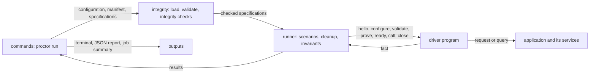

# Architecture

`proctor` is one Go program. It reads the protected inputs, checks them, and runs each step through a driver: a separate program it starts and speaks to with JSON-RPC 2.0 over the driver's stdin and stdout (the protocol module, `github.com/bezmoradi/proctor/protocol`). Drivers send every step's requests and queries. `proctor` itself contacts only GitHub (the update check, and in authoritative mode the OIDC keys and the CODEOWNERS API) and, with `app_logs.otel`, the `proctor-sim-otel` receiver.

## A run

In authoritative mode, `commands` also verifies the job's identity and asks GitHub for CODEOWNERS errors (`github`), reads the inputs from the tested commit (`gitrepo`), and lists the protected changes against the base (`protdiff`), before any driver starts.

## Packages

`.go-arch-lint.yml` lists which package may import which, and `scripts/check-arch.sh` enforces it in CI, together with the rule that `internal/model`, `internal/expr`, `internal/transcript` and `internal/strictyaml` touch no files, processes or network.

| Package | Responsibility |
|---|---|
| `cmd/proctor`, `internal/commands` | The command line: flags, modes, terminal output, reports, the update check |
| `internal/model` | The types of `proctor.yaml`, the manifest, specifications, tables and bindings |
| `internal/strictyaml` | Strict YAML decoding: unknown and duplicate keys, anchors, aliases and tags are refused |
| `internal/expr` | Fact paths and `${...}` references |
| `internal/integrity` | Loading the protected inputs from the working tree or a commit, validation, integrity checks and `requires` |
| `internal/runner` | Starting the drivers, readiness and proofs, running scenarios, tables, cleanup and invariants, matching expectations, scrubbing |
| `internal/transcript`, `internal/applogs` | Approved transcripts, and reading, checking and approving application logs |
| `internal/protdiff` | The semantic diff of protected changes, weakenings and change kinds |
| `internal/gitrepo`, `internal/github` | Reading Git objects; GitHub's OIDC token and CODEOWNERS API |
| `internal/mutate`, `internal/mutgen`, `internal/mutreport` | Mutation runs, generating mutants, and the HTML report |

## Repository layout

| Path | Contents |
|---|---|
| `cmd/proctor`, `internal/` | The CLI |
| `drivers/<name>/` | The official drivers, one Go module each (`browser`, `cli`, `docker`, `dynamodb`, `http`, `otel`, `postgres`, `redis`, `ses`, `sqs`, `stub`, `ws`) |
| `protocol/` | The protocol between `proctor` and its drivers, Go module `github.com/bezmoradi/proctor/protocol`; `protocol/cmd/proctor-driver-example/` is a driver to copy for a [repository driver](guides/repository-drivers.md) |
| `simulators/ses/` | `proctor-sim-ses`, a local SES stand-in for the ses driver |
| `simulators/http/` | `proctor-sim-http`, a general HTTP fake for the stub driver |
| `simulators/otel/` | `proctor-sim-otel`, a local OTLP/HTTP receiver for the otel driver |
| `scripts/build.sh` | Builds `proctor`, its drivers and the simulators |
| `scripts/release.sh`, `.github/workflows/release.yml` | Builds the release archives; drafts a release from a `v*` tag on main |
| `scripts/install.sh`, `scripts/release-install.sh` | The install script's template, which refuses to run; `release.sh` renders it into the release with the version and the archives' checksums |
| `.github/workflows/ci.yml`, `pull-requests.yml`, `workflow-guard.yml` | CI and pull request checks |
| `.github/workflows/proctor.yml` | The [self-check](development.md#self-check) in authoritative mode |
| `.github/rulesets/` | The branch and tag rulesets the owner applies on GitHub |
| `.go-arch-lint.yml`, `scripts/check-arch.sh` | Which packages may import which; `internal/model`, `internal/expr`, `internal/transcript` and `internal/strictyaml` stay free of file, process and network access |
| `examples/github/` | The reference GitHub workflow and CODEOWNERS file |
| `examples/github/verify/` | An example disposable environment for the workflow, copied to `proctor/verify/` |
| `examples/sample/` | A sample users API and its `proctor/` folder, with the `kafka` repository driver, run end to end in CI |
| `proctor/` | Proctor's check of itself with the cli driver, run in CI (see [Self-check](development.md#self-check)) |
