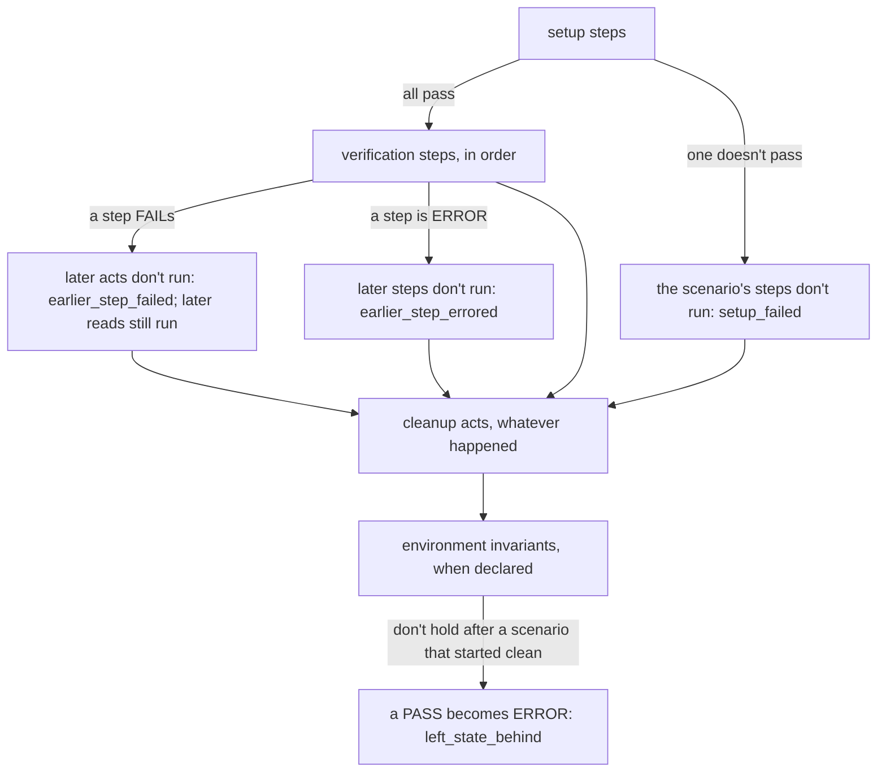

# Writing specifications

A specification is a suite of scenarios, and a scenario a list of steps, such as the quick start's `proctor/specs/users.yaml`. A step names a driver's operation in `do`, the identity it acts as, the operation's arguments in `with`, what the answer must hold in `expect`, and the values it `save`s for later steps.

How a scenario's steps run:



A step that observes can be sampled until its expectations hold (`eventually`), or must keep them at every sample (`consistently`) or at none (`never`):

```yaml
- id: activated
  do: http.request
  identity: anonymous
  with: { method: GET, path: "/api/v1/users/${user_id}" }
  expect:
    equal: { $.status: 200, $.body.data.state: active }
  eventually: { within: 10s, every: 500ms }
```

`consistently` and `never` take `for` instead of `within`. A step that acts can't be sampled (TIME-11), and the window and interval are bounded by `time_limits` in `proctor.yaml`. Samples are due every `every` from the first and at the window's end, and the last one always runs; a sample that overruns due times is followed at once by one for the latest, and the missed ones are counted in the step's `samples_skipped` (TIME-08). A passing `consistently` or `never` step has a `notice` in the JSON report, and the run prints one `Note:` line counting them, because samples can't see a change between them or after the window (TIME-05).

A scenario or table with `requires: disposable_environment` runs only when the binding says `disposable: true`; otherwise it is NOT_RUN `disposable_environment_required` (exit 2).

## Step timeouts

A step waits `--call-timeout` (10 s by default) for each call. A slow one can set its own `timeout`, and `time_limits.max_call` in `proctor.yaml` bounds it:

```yaml
# proctor/proctor.yaml
time_limits: { max_call: 120s }
```

```yaml
- id: start
  do: http.request
  identity: alice
  timeout: 120s
  with: { method: POST, path: /api/exports, body: { name: "x-${run.id}" } }
  expect:
    equal: { $.status: 202, $.body.state: started }
```

`max_call` defaults to 60 s. Validation refuses (exit 3, TIME-13) a step timeout longer than it, zero, negative or without a unit, and `run` refuses a `--call-timeout` longer than it before anything is sent, so the longest wait is always in a protected file. `proctor diff` lists a raised `max_call` as `max_call_longer`, and a step timeout added, raised or removed as `step_timeout_longer`; a lowered one is a changed expectation.

## Tables

A table can carry `eventually`, `consistently` or `never`, and `timeout`, as a scenario's step does; each row is sampled on its own (TBL-08):

```yaml
tables:
  - id: settled
    name: each export settles
    do: http.request
    identity: alice
    with: { method: GET, path: "/exports/${row.id}" }
    expect:
      equal: { $.status: 200, $.body.state: done }
    eventually: { within: 10s, every: 500ms }
    columns: [case, id]
    rows:
      - [csv, "${csv_export}"]
      - [pdf, "${pdf_export}"]
```

A row that acts (a POST that isn't a declared read) can't be polled and is refused by name (TIME-11); a mistake in the values is reported once for the table.

A table can claim to cover every combination of some dimensions, such as every route × every refused method (TBL-07). The dimensions and the sets of combinations live in a protected file that `proctor.yaml` names, and a table names its set with `covers`:

```yaml
# proctor/proctor.yaml
dimensions: dimensions.yaml
```

```yaml
# proctor/dimensions.yaml
version: 1
dimensions:
  post_routes: [/api/add-item, /api/remove-item, /api/login]
  other_methods: [PUT, DELETE, PATCH]
sets:
  missing_key:
    columns: { route: post_routes }
    except:
      - cells: { route: /api/login }
        reason: "/api/login signs in without a key; login.yaml checks it"
  wrong_method:
    columns: { route: post_routes, method: other_methods }
```

```yaml
tables:
  - id: CART-T05
    name: a POST route refuses PUT, DELETE and PATCH
    do: http.request
    identity: alice
    with: { method: "${row.method}", path: "${row.route}", body: {} }
    expect:
      equal: { $.status: 405 }
    covers: wrong_method
    columns: [case, route, method]
    rows:
      - [t05_put_add_item, /api/add-item, PUT]
      - [t05_delete_add_item, /api/add-item, DELETE]
```

Across the tables that cover a set (in any listed file, tables without an `id` included), every combination of the set's dimensions, minus its `except` entries, must have exactly one row. Validation fails (exit 3, TBL-07) on:

- a missing combination, named as `no row for (route="/api/remove-item", method="PATCH")` after a line with the count; at most 50 are listed per set, then the number left;
- a combination with two rows (both are named), and a covered cell that isn't a value of its dimension;
- `covers` naming an unknown set, a column the table lacks, its case id column, or a column the step isn't built from (only `identity`, `variant` and `with` count);
- a set no table covers, a dimension no set uses, a repeated or non-scalar value, and a set of more than 100,000 combinations;
- an exception that names a value outside its dimension, leaves out a column, repeats another, also has a row, or has no reason.

Values are compared as written, before `${...}` is replaced, and with their YAML type, so `"7"` isn't `7`. `proctor diff` lists a value no longer in a dimension, or a column that now takes a dimension without it, as `dimension_value_removed`; a removed set, set column, `dimensions` key or table `covers` as `coverage_dropped`; and a new exception as `coverage_exception_added`. Adding a value, a set or a column only adds checks.

## Cleanup

A scenario or a table can list `cleanup:` acts, which run after its steps whatever happened, a failed setup included; a table's cleanup runs once after each row (EXE-14):

```yaml
- id: ORD-010
  name: A placed order can be read
  steps:
    - id: place
      do: http.request
      identity: anonymous
      with: { method: POST, path: /api/orders, body: { note: "o ${run.id}" } }
      expect: { equal: { $.status: 201, $.body.state: pending } }
      save: { order: $.body.id }
    - id: check
      do: http.request
      identity: anonymous
      with: { method: GET, path: "/api/orders/${order}" }
      expect: { equal: { $.status: 200, $.body.state: pending } }
  cleanup:
    - id: cancel
      do: http.request
      identity: anonymous
      with: { method: POST, path: /api/cancel-order, body: { id: "${order}" } }
      expect: { equal: { $.status: 200 } }
```

A cleanup step that fails turns a passing scenario into ERROR `cleanup_failed`; a failing scenario stays FAIL, with its `first_failure`, and the cleanup is reported apart (`cleanup` and `cleanup_failure` in the report, a `cleanup <result>` line in the terminal and on the progress line). A cleanup step that needs a value whose step didn't run, or a handle that isn't open, is NOT_RUN with nothing sent. A destructive act on a fixed target that EXE-09 accepts because an earlier step guards it is sent only when every earlier step passed (otherwise NOT_RUN `cleanup_unguarded`), since a guard that failed may have found someone else's data; one that waives EXE-09 is always sent. Cleanup steps only act: a step that observes, `eventually`, `consistently`, `never`, `save`, `no_state_check`, `as` and credential variants are refused there (exit 3), and they need no state check (EXE-07). They run inside the scenario's app-log window and appear in its transcript. After an interrupt the drivers are stopped, so the cleanup is NOT_RUN `aborted`. `proctor diff` lists a removed cleanup step (`cleanup_step_removed`), a verification step moved into cleanup (`step_moved_to_cleanup`) and a loosened cleanup expectation as weakenings.

A teardown kept as steps is evidence, but it doesn't run once an earlier step fails. To free what the scenario created then, add a fallback cleanup step with `unless_passed`, naming the setup or verification step it stands in for:

```yaml
- id: SES-010
  name: A started session can be stopped
  steps:
    - id: start
      do: http.request
      identity: anonymous
      with: { method: POST, path: /api/sessions }
      expect: { equal: { $.status: 201 }, present: [$.body.id] }
      save: { session: $.body.id }
    - id: stop
      do: http.request
      identity: anonymous
      with: { method: POST, path: "/api/sessions/${session}/stop" }
      expect: { equal: { $.status: 202, $.body.state: stopping } }
    - id: stopped
      do: http.request
      identity: anonymous
      with: { method: GET, path: "/api/sessions/${session}" }
      expect: { equal: { $.status: 200, $.body.state: stopped } }
  cleanup:
    - id: stop-fallback
      unless_passed: stop
      do: http.request
      identity: anonymous
      with: { method: POST, path: "/api/sessions/${session}/stop" }
      expect: { equal: { $.status: 202 } }
```

When the named step passed, the cleanup step is NOT_RUN `cleanup_not_needed` and nothing is sent. It doesn't count against the scenario: the scenario keeps its result, `cleanup_failure` stays empty, and later cleanup steps run as if it had passed; the summary's step counts list it as not run. When the named step failed, errored or didn't run, the cleanup step runs under every rule above. In a table, it names a setup step of the table or `case`, the row's own step, and is decided for each row. Validation refuses (exit 3, EXE-14) `unless_passed` outside cleanup, an empty or null one, one naming a cleanup step or no step, and one on a destructive act on a fixed target that an earlier step guards, which `cleanup_unguarded` would hold back whenever `unless_passed` lets it run: target `${run.id}` or a saved value instead. A Proctor older than the `cleanup.unless_passed` feature refuses the key as unknown. `proctor diff` lists adding `unless_passed` to a cleanup step (`cleanup_made_conditional`) and changing the step it names (`cleanup_condition_changed`) as weakenings, since the step then runs less often; a new cleanup step with it isn't one.

## Environment invariants

A scenario that fails part-way can leave behind what it created, and the scenarios after it then fail for that reason alone. Declare in `proctor.yaml` the state that must hold between scenarios, as read-only checks:

```yaml
invariants:
  - id: no-sessions
    do: http.request
    identity: anonymous
    with: { method: GET, path: /api/sessions }
    expect: { equal: { $.status: 200, $.body.count: 0 } }
```

Proctor checks every invariant before the first scenario and after each scenario and table row that ran, after its cleanup:

- If one doesn't hold after a scenario that started in a clean environment, the scenario left state behind: a PASS becomes ERROR `left_state_behind`, and a FAIL or ERROR keeps its result. Either way `left_state_behind` in the report, and the terminal under the scenario, show each invariant that failed, with its expected and actual values.
- Every later scenario carries `dirty_since: <id>` (`[environment dirty since <id>]` in the terminal) until the invariants hold again, so its failure can be read as a likely consequence. A scenario that ran in a dirty environment isn't blamed for it. When they don't hold before the first scenario, the report's `dirty_at_start` shows them and the first scenarios carry `dirty_since: the start of the run`.
- An invariant that can't be checked, such as one that times out, is ERROR, and the environment's state is then unknown, not dirty. Before the first scenario that stops the run: every scenario is NOT_RUN `invariant_error` (exit 2), and `dirty_at_start` shows the invariant. After a scenario, a PASS becomes ERROR `invariant_error`, `invariant_errors` shows the invariants, and the next scenario is judged as usual.

An invariant only observes: its driver must describe it as a read, and `save`, `as`, `on`, `variant`, `consistently`, `never`, `no_state_check`, `waive`, `unless_passed`, `${run.id}`, saved values and `${row.…}` are refused (exit 3, INV-01). `eventually` lets it wait, for a container that takes a moment to go. It never acts, so it can't hide what a scenario left. Its identity must be declared (INT-12), and its credentials are loaded whichever scenarios a run selects, so `--only` and `--rerun-failed` check it too. With `app_logs`, its requests aren't in any scenario's log window: Proctor waits `app_logs.flush_wait` before and after the invariants, so each check after a scenario or table row adds up to two waits. A specification set without `invariants` runs as before. `proctor diff` lists a removed invariant (`invariant_removed`) and a changed one (`invariant_changed`) as weakenings, and an added one with the other changes.

## Application logs

With `app_logs` in `proctor.yaml` and `app_logs: { file: <absolute path> }` in the binding, any line at a failing level (ERROR, FATAL or PANIC by default) that the application writes to that file during a scenario fails it, unless the scenario lists it under `expect_logs` (EXE-10). Lines are JSON objects by default; `format: logfmt` reads `key=value` lines as Go's `slog.TextHandler` writes them, and `level_numbers: { 30: INFO, 50: ERROR, 60: FATAL }` maps numeric levels such as pino's; map every number the application writes, since an unmapped one is ERROR (`app_logs_unmapped_level`). A log line that doesn't read under the declared format is ERROR (`app_logs_unparsed`), never a pass, except a panic's stack trace; `unparsed: allow` skips such lines, and `proctor diff` reports adding it as a weakening.

An application that exports its logs over OTLP is checked the same way with `app_logs: { otel: <endpoint> }` in the binding, the address of the `proctor-sim-otel` receiver it exports to (see [Telemetry](../reference/drivers.md#telemetry)), instead of `file`; give exactly one of the two (exit 3). The window is the receiver's log records from the scenario's start to its end, whoever sent them, so an undeclared ERROR from any service fails the scenario. A record's level is its `severity`, its message the body as text, and it reads as one JSON line, `{"time","level","msg","service","trace_id","span_id",<attributes>}`, with an attribute whose name clashes with one of those under `attributes`; `expect_logs`, approved logs and redaction work as with a file. A record without a severity is ERROR `app_logs_unparsed` unless `unparsed: allow`, and `format`, `level_field`, `message_field` and `level_numbers` can't be set with `otel` (exit 3). A receiver that refuses log records during a scenario (it's full, or a record is too large), or restarts, makes the scenario ERROR `app_logs_unreadable`.

Before reading the window, a scenario waits `app_logs.flush_wait` for the application's last lines: `300ms` by default with a file, `1500ms` with `otel` (exporters send logs in batches), at most `10s`.
